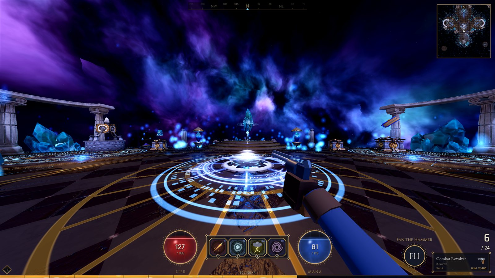
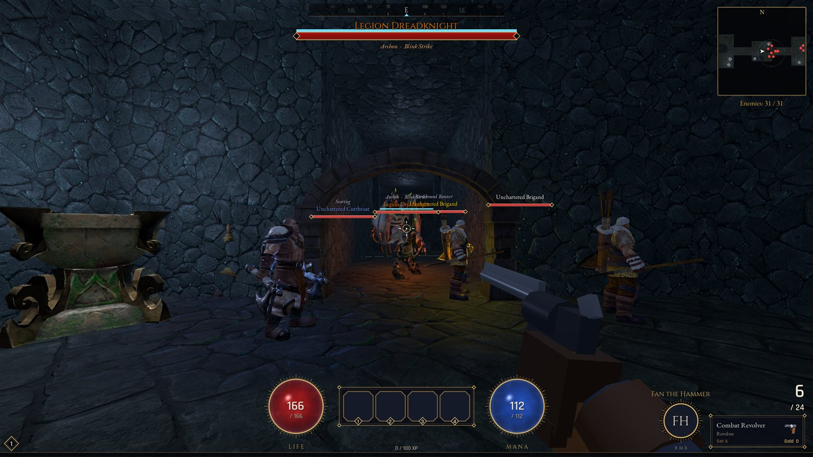
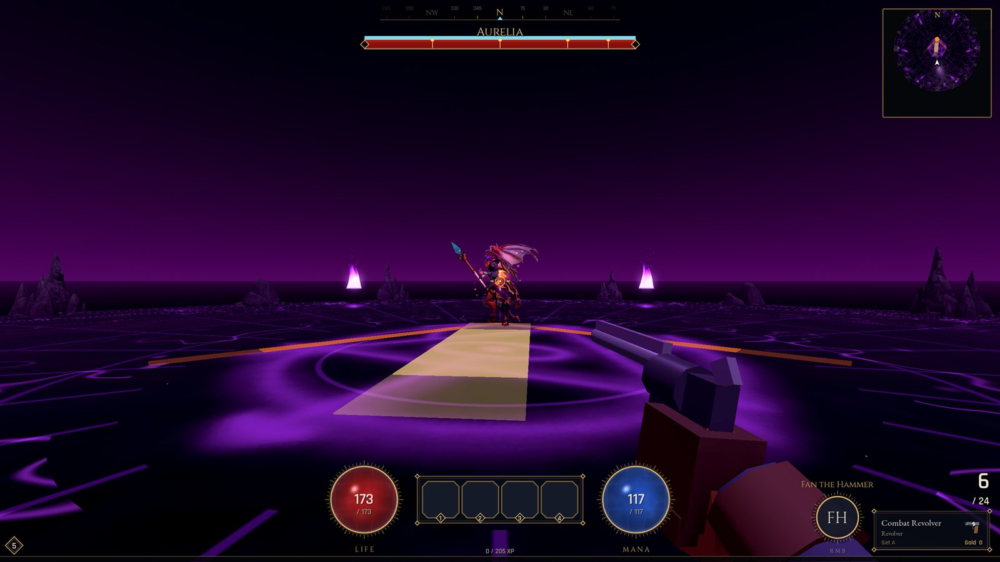
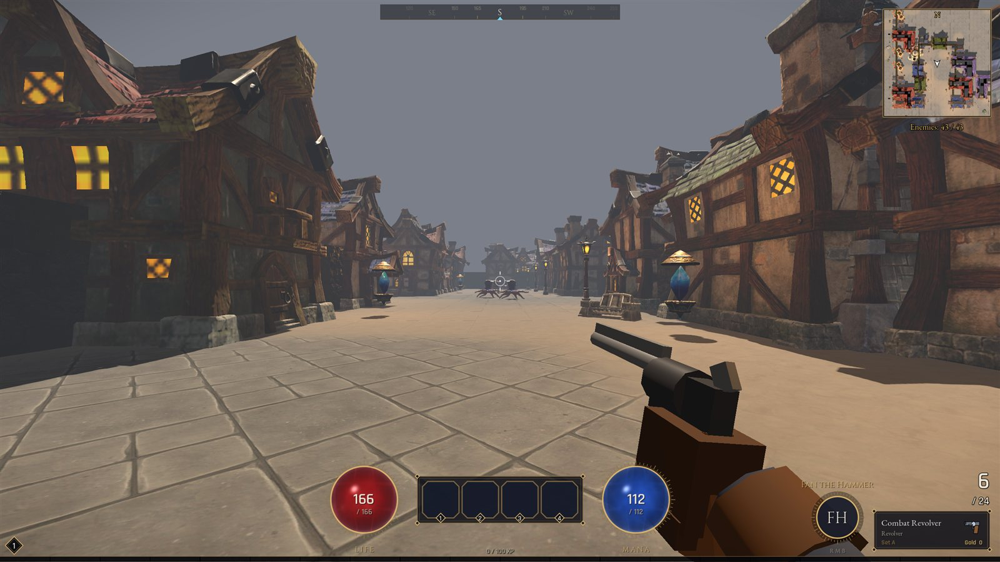
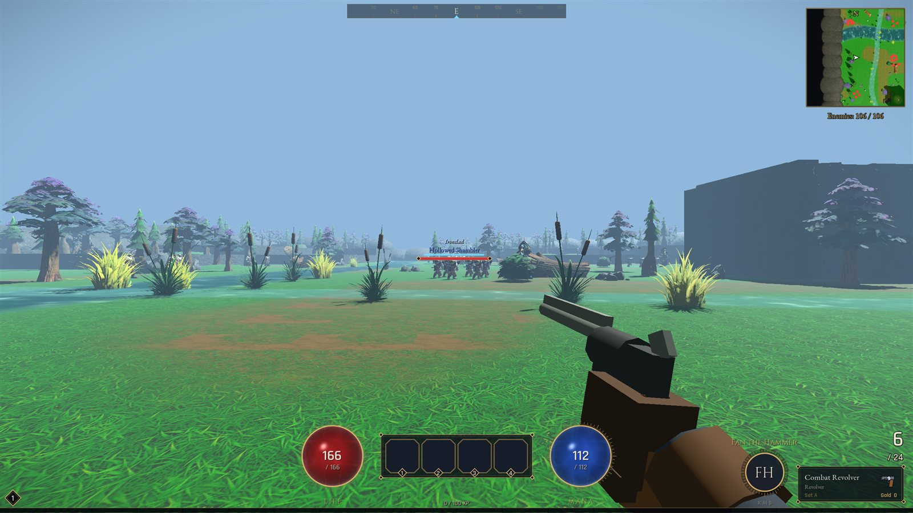
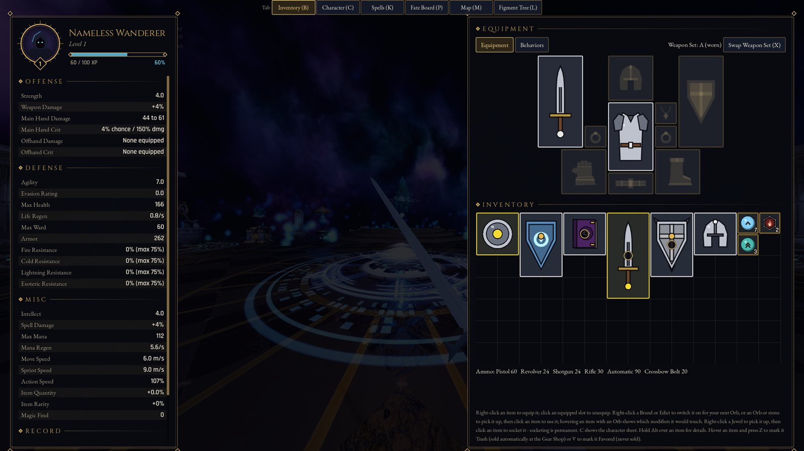

# Project Aether

A first-person action RPG with endgame-first loot and build-crafting, made in Godot 4.7.1.

[](https://discord.gg/8uvrTAZcrS)

You start in the **Memory Nexus**, a hub floating in the void, and step through the Reality Engine into procedurally generated **Figments** full of enemies, loot and bosses. Fight up close with swords, polearms and fists, at range with bows and guns, or with spells channelled through conduits, then bring the loot home to craft and refine your build.



> **Early development build.** Expect rough edges and frequent balance changes.
> Most art and audio are **placeholders made by other creators** and will be
> replaced. See [Credits](#credits).

## Download

Grab the latest build from the [Releases page](https://github.com/bmdearing/Project-Aether/releases/latest).

| Platform | File | Run |
|---|---|---|
| Windows 64-bit | `ProjectAether-<version>-windows.zip` | Unzip, run `ProjectAether.exe` |
| Linux 64-bit | `ProjectAether-<version>-linux.tar.gz` | `tar -xzf` it, run `./ProjectAether.x86_64` |
| macOS (Intel, and Apple Silicon) | `ProjectAether-<version>-macos.zip` | Unzip, right-click `Project Aether.app` > Open (the app is not notarized) |

Each build is self-contained, with all assets inside.

## Screenshots

| | |
|---|---|
|  |  |
|  |  |
|  | |

## Features

- **Hub and Figments:** procedurally generated maps (dungeons, open fields, canyons and city streets in Dungeon, Desert, Snow, Forest and Steampunk City styles, each with its own layout), Vault rooms, portals home, and pinnacle bosses.
- **Endgame mapping:** Figment tiers 1-21 in Low, Mid and High bands, three pools of monster and boss modifiers that pay back in Pack Size, Item Quantity and Item Rarity, and a Figment Tree, earned by first clears, that steers which areas, factions, monsters and rewards your Figments roll.
- **Weighty first-person combat:** a three-hit melee combo with light, heavy and charged attacks; parry, riposte, counter hits and visceral finishers on staggered enemies; dash-cancels and quicksteps with i-frames; hit-stop and blood; and weapon stances for every weapon family.
- **Every weapon feels different:** each weapon family has its own attack, recoil, reload and bow-draw animations, and casters get channelled stances.
- **Ranged weapons:** magazines, reloading, fire modes and spread for pistols, rifles, shotguns, bows and crossbows.
- **Verticality and secrets:** catch ledges and mantle up, climb raised rooms and staircases, and find hidden rooms behind cracked walls and in rock outcrops, some guarded by the Watcher and its bargains.
- **Defense:** passive shield block, or an active raised-shield guard that spends Composure.
- **Loot and builds:** rolled gear with tiered modifiers, Uniques and Mythics, jewels and sockets, a grid inventory and stash, vendor shops and a Currency Exchange, crafting with Orbs, Brands, Edicts and the Shard of Tharsis, the Fate Board of Slates and Lenses, and spells with their own skill webs.

## Controls

| Action | Key |
|---|---|
| Move / Look | WASD / Mouse |
| Sprint (tap to dash) / Jump / Crouch (tap while sprinting to slide) | Shift / Space / Ctrl |
| Attack: tap for light, hold for heavy | Left Mouse |
| Stance / aim / raise shield (hold) | Right Mouse |
| Parry | F |
| Spells (hold and release to aim targeted spells) | 1-4 |
| Reload | R |
| Gun bash (with a ranged weapon out) | V |
| Swap weapon set (tap) / stance page (hold) | X |
| Interact | E |
| Show distance rings (5 / 10 m, marks at 15 / 20 / 25 m) | Alt (hold) |
| Portal to the Hub | T |
| Inventory / Character / Spells / Fate Board / Map / Figment Tree | B / C / K / P / M / L |
| Menu: open the last screen, then cycle screens (Shift: backwards) | Tab |
| Mark hovered item as Trash / Favored | Z / V |
| Copy hovered item as text | Ctrl+C |
| Pause | Esc |

Every key can be rebound in Settings > Controls.

## Building from source

1. Install [Godot 4.7.1](https://godotengine.org/download) (the project uses the Forward+ renderer and falls back to Compatibility on GPUs without Vulkan or D3D12).
2. Clone this repository and open `project.godot` in Godot.
3. Press F5 to run. The main menu is `ui/main_menu/MainMenu.tscn`.

To export, install the 4.7.1 export templates (Editor > Manage Export Templates), add Windows Desktop, Linux and macOS presets, then run:

```
godot --headless --export-release "Windows Desktop" builds/windows/ProjectAether.exe
godot --headless --export-release "Linux" builds/linux/ProjectAether.x86_64
godot --headless --export-release "macOS" builds/macos/ProjectAether-macos.zip
```

## Project layout

| Folder | Contents |
|---|---|
| `entities/` | Player, enemies, projectiles, interactables |
| `systems/` | Combat, abilities, equipment, crafting, inventory, level generation |
| `data/` | Weapons, armor, shields, abilities, enemies, stances (`.tres` resources) |
| `levels/` | Hub, generated maps, boss arena, main-menu background |
| `ui/` | HUD, inventory, character screen, Fate Board, menus |
| `autoloads/` | Game state, events, saving, constants |
| `tests/` | Headless test suites (`godot --headless --path . res://tests/<suite>.tscn`) |
| `tools/` | Warcraft III MDX-to-glTF model converter |

## Community

Come chat, share feedback and report bugs on the [Project Aether Discord](https://discord.gg/8uvrTAZcrS). Bug reports are also welcome as [GitHub issues](https://github.com/bmdearing/Project-Aether/issues).

## Documentation

- [`DEVELOPMENT.md`](DEVELOPMENT.md): system-by-system reference, numbers sourced from the design docs, and open design gaps
- [`PATCH_NOTES.md`](PATCH_NOTES.md): full change history
- `documents/`: design documents

## Credits

Code and design by [bmdearing](https://github.com/bmdearing).

**All third-party art and audio in this project are placeholders.** They belong to their creators, are not owned by this project, and will be replaced with original or properly licensed assets as soon as possible. Full attribution is in [`CREDITS.md`](CREDITS.md). Highlights:

- Weapon models: Low Poly Weapon Pack by Kickin It Studios
- Character, enemy and environment models: Warcraft III custom models by vindorei, Missing Shadowsong, Superfrycook, Mr Ogre man, Fugrim, sadirexi, Raddazong, drew1011, dehme and Shadow44 via [Hive Workshop](https://www.hiveworkshop.com)
- Some props and textures: Warcraft III: Reforged. Warcraft is a trademark of Blizzard Entertainment, Inc.
- Animations: Universal Animation Library by [Quaternius](https://quaternius.com) (CC0)

If you created something used here and want it credited differently or removed, please [open an issue](https://github.com/bmdearing/Project-Aether/issues).
